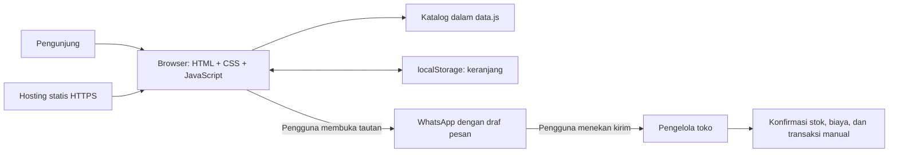
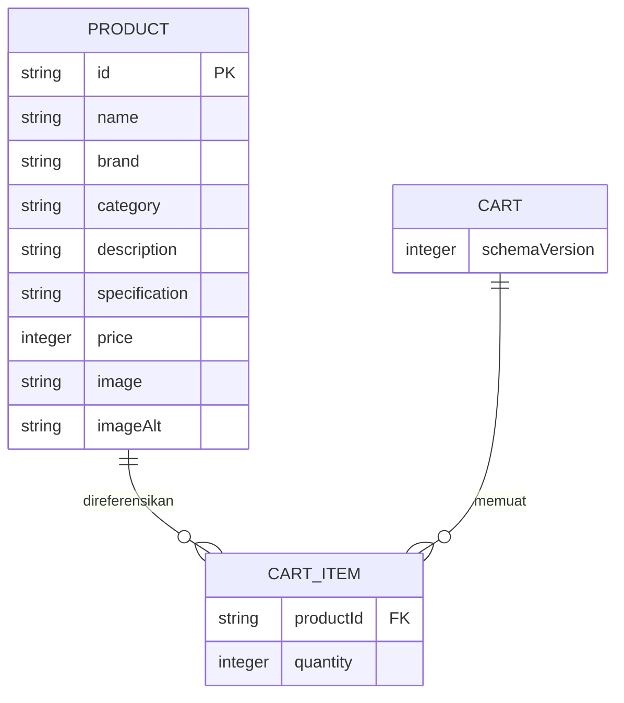

# Arsitektur Sistem — Website Penjualan Helm Premium

## 1. Bentuk sistem

Aplikasi MVP merupakan frontend statis satu halaman yang dibagi menjadi modul JavaScript. Tidak menggunakan microservices atau backend monolith. Hosting mengirimkan HTML, CSS, JavaScript, dan gambar. Pencarian, filter, keranjang, serta perhitungan belanja berjalan di browser.



## 2. Struktur berkas aplikasi

```text
ojank-helmet/
├── index.html
├── css/
│   └── styles.css
├── js/
│   ├── config.js       # Identitas toko dan nomor WhatsApp publik
│   ├── data.js         # Data katalog helm dan aksesori
│   ├── app.js          # Inisialisasi, render, pencarian, filter
│   ├── cart.js         # Manipulasi keranjang dan perhitungan
│   ├── storage.js      # Baca/tulis aman dan validasi skema
│   └── checkout.js     # Validasi formulir dan pembentukan tautan
├── assets/
│   └── images/         # Logo, banner, dan foto produk
├── prd.md
├── tech_stack.md
├── arsitektur.md
├── ui.ux.md
├── instruction.md
└── verification.md
```

Struktur ini merupakan rancangan file untuk implementasi website helm; keberadaan dokumen belum berarti website telah dibuat.

## 3. Model data



Diagram menggambarkan objek frontend, bukan tabel database server. Subtotal dan total merupakan nilai turunan yang dihitung ulang dari katalog dan jumlah barang.

Contoh struktur penyimpanan `localStorage`:

```json
{
  "schemaVersion": 1,
  "items": [
    { "productId": "helm-premium-001", "quantity": 1 }
  ]
}
```

## 4. Alur kerja

### Memuat halaman

1. Muat konfigurasi toko dan katalog lokal.
2. Baca `localStorage` dalam `try/catch`.
3. Validasi versi, tipe data, ID produk yang dikenal, dan jumlah bulat 1–99.
4. Abaikan entri rusak atau ID yang tidak ada; reset versi skema yang tidak dikenal.
5. Render katalog, keranjang, subtotal, dan total berdasarkan harga katalog terkini.

### Mengubah keranjang

1. Terima ID produk dari kontrol UI dan cocokkan dengan katalog.
2. Tambah atau ubah jumlah pada state tunggal.
3. Hitung ulang subtotal dan total.
4. Render ulang dan simpan hanya bagian state yang diperbolehkan.
5. Jika penyimpanan gagal, pertahankan state sesi dan tampilkan pemberitahuan singkat.

### Mengajukan pembelian

1. Validasi keranjang, nama, dan nomor kontak.
2. Tampilkan ringkasan final termasuk produk, jumlah, harga, dan total estimasi.
3. Susun pesan berdasarkan katalog dan state terbaru; encode teks menggunakan `encodeURIComponent`.
4. Bentuk tautan `https://wa.me/<nomor-toko>?text=<pesan>` dari nomor internasional berupa digit saja.
5. Buka tautan setelah tindakan pengguna. Website tidak mengirim pesan secara otomatis dan tidak boleh menampilkan status “pesanan berhasil”.
6. Pertahankan keranjang setelah pengalihan; pengajuan bukan bukti transaksi.

## 5. Perhitungan harga

Harga disimpan sebagai bilangan bulat rupiah. Subtotal produk dihitung dengan rumus:

`subtotal = harga satuan × jumlah`

Total dihitung dengan menjumlahkan seluruh subtotal. Gunakan `Intl.NumberFormat('id-ID', { style: 'currency', currency: 'IDR', maximumFractionDigits: 0 })` untuk format rupiah. Harga harus diambil dari katalog sumber, bukan dari nilai yang dapat diubah di browser.

## 6. Integrasi dan batas kepercayaan

WhatsApp merupakan satu-satunya integrasi pihak ketiga pada MVP, melalui tautan biasa tanpa SDK/API. Data kontak dan rincian pesanan akan masuk ke URL WhatsApp ketika pengguna menekan tombol. Beri penjelasan di dekat tombol. Jangan meminta data sensitif seperti nomor identitas. Browser dan `localStorage` dapat dimodifikasi pengguna sehingga harga dan stok harus dikonfirmasi pengelola.

## 7. Keamanan dan penanganan kegagalan

Gunakan `textContent` untuk input pengguna dan data dinamis; hindari interpolasi input ke `innerHTML`. Jika memakai tab baru, gunakan `rel="noopener noreferrer"`. Jangan menyatakan stok tersedia jika belum diverifikasi. Gambar gagal dimuat harus memiliki fallback lokal. Pencarian kosong, storage tidak tersedia, dan konfigurasi nomor toko yang tidak valid harus memiliki keadaan UI yang jelas. Sertakan pesan `noscript` untuk fitur interaktif.

## 8. Deployment

Unggah aset runtime ke hosting statis melalui HTTPS. Tidak ada proses build, migrasi database, atau fungsi server pada MVP. Dokumentasi internal tidak harus masuk paket publik. Simpan paket versi sebelumnya untuk rollback.
